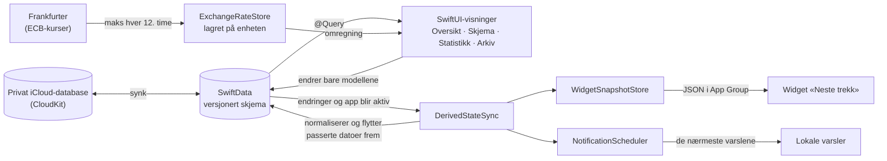

<div align="center">


# Subtrack

**Full oversikt over abonnementene dine: hva de koster, når de fornyes, og hva du har spart på dem du har sagt opp.**


</div>

> [!IMPORTANT]
> **Koden er åpen for innsyn, men er ikke åpen kildekode.** Du kan lese den her på GitHub, men ikke bruke, kopiere, endre, bygge eller distribuere den uten skriftlig tillatelse fra Opland Tech Nettverk. Se [Lisens](#lisens).

## Innhold

- [Om appen](#om-appen)
- [Funksjoner](#funksjoner)
- [Slik fungerer det](#slik-fungerer-det)
- [Designvalg](#designvalg)
- [Teknologi](#teknologi)
- [Krav](#krav)
- [Prosjektstruktur](#prosjektstruktur)
- [Testing](#testing)
- [Personvern](#personvern)
- [Bidrag og tilbakemeldinger](#bidrag-og-tilbakemeldinger)
- [Lisens](#lisens)

## Om appen

Subtrack er en app for iPhone og iPad som samler alle abonnementene dine på ett sted. Du legger inn pris, valuta og hvor ofte abonnementet fornyes, og appen holder styr på resten: neste trekk, hva alt koster per måned og per år, påminnelser før fornyelser og prøveperioder som går ut, og hvor mye du har spart på det du har sagt opp.

Appen er skrevet i Swift og SwiftUI, bruker bare Apples egne rammeverk og har brukergrensesnitt på norsk (bokmål). Dataene synkroniseres mellom enhetene dine via din egen private iCloud-database.

## Funksjoner

### Oversikt over abonnement

- **Sammendrag øverst** med total kostnad **per måned** og **per år** for alt som faktisk koster penger nå, omregnet til hovedvalutaen din. Pausede og avsluttede abonnement holdes utenfor.
- **Hver rad** viser navn, intervall, pris og hvor lenge det er til neste trekk («I dag», «I morgen», «Om 5 dager»). Passerte datoer flyttes automatisk frem til neste fornyelse.
- **Fire sorteringer:** neste fornyelse, pris (høyest først, omregnet til hovedvalutaen så ulike valutaer sammenlignes riktig), navn eller kategori. Ved sortering på kategori får hver kategori sin egen seksjon. Valget huskes.
- **Søk** i navn og kategori, uten å skille på store og små bokstaver eller aksenter.
- **Sveipehandlinger:** sveip til høyre for å pause eller gjenoppta, til venstre for å redigere eller avslutte.
- **Kategorier** (Streaming, Musikk, Programvare, Trening, Nettsky og Annet) med eget standardikon, og mulighet til å velge **eget ikon og egen farge** per abonnement.
- **Haptisk tilbakemelding** når du lagrer, pauser, avslutter, gjenopptar eller sletter.

### Legge inn og redigere

- **Intervaller:** ukentlig, månedlig, kvartalsvis og årlig.
- **Pris skrives slik folk faktisk skriver den:** «149,90», «1 000», «1.234,50» og «1,234.50» godtas. Tvetydige verdier som «1,2,3» avvises med en tydelig feilmelding i stedet for at appen gjetter.
- **Notat** og **avslutningslenke** per abonnement. Lenken kan skrives uten `https://` (for eksempel `netflix.com/cancel`) og kan åpnes direkte fra skjemaet.
- **Ingen endringer går tapt ved et uhell:** har du endret noe, må du bekrefte før skjemaet forkastes, og det kan ikke sveipes bort.

### Valutaer og omregning

- Abonnement kan legges inn i **30 valutaer**. Totaler, sortering, statistikk og besparelser regnes om til **hovedvalutaen** du velger i innstillingene (standard er NOK).
- Kursene er referansekursene fra **Den europeiske sentralbanken**, hentet via [Frankfurter](https://frankfurter.dev). Appen henter kurser med EUR som base og regner ut kryss-kurser lokalt.
- Kursene **lagres på enheten**, så omregningen fungerer uten nett med siste kjente kurs. Nye kurser hentes når appen blir aktiv og de lagrede er eldre enn 12 timer. Feiler hentingen, brukes de forrige videre.
- Appen viser hvilken dato kursene gjelder for. Mangler det kurs for et abonnement, utelates det fra summen, og du får beskjed om hvor mange som ikke er tatt med, i stedet for at totalen blir feil uten forvarsel.

<details>
<summary>Støttede valutaer</summary>

AUD, BRL, CAD, CHF, CNY, CZK, DKK, EUR, GBP, HKD, HUF, IDR, ILS, INR, ISK, JPY, KRW, MXN, MYR, NOK, NZD, PHP, PLN, RON, SEK, SGD, THB, TRY, USD og ZAR.

</details>

### Delte abonnement

Del kostnaden likt med andre, for eksempel et familieabonnement. Du velger hvor mange dere er (inkludert deg selv), og skjemaet viser hva din del blir. Raden, totalene og statistikken bruker din andel, og raden viser at abonnementet er delt.

### Gratis prøveperioder

Slå på «Gratis prøveperiode», så blir datoen du velger dagen prøveperioden slutter og første betaling skjer. Listen og widgeten viser «Prøve slutter om …», og varselet får egen tekst som sier hva du blir belastet og når, så du rekker å si opp. Avslutter du i prøveperioden, regnes besparelsen først fra dagen du ellers ville betalt.

### Påminnelser

- **Varsel før hver fornyelse**, fra 0 til 30 dager før (standard er 3), klokken 09:00.
- **Reservetidspunkt når fristen er passert:** legger du inn et abonnement som fornyes i morgen med varsel tre dager før, får du i stedet varsel dagen før eller samme morgen. Aldri tidligere enn du har bedt om, og aldri et ekstra varsel for en fornyelse du allerede er varslet om.
- **Knappen «Avslutt abonnement»** på varselet åpner avslutningssiden direkte når abonnementet har en avslutningslenke.
- **Smart prioritering:** iOS tillater bare et begrenset antall ventende varsler per app. Subtrack planlegger derfor de nærmeste varslene på tvers av alle abonnement innenfor et felles budsjett, og planlegger på nytt hver gang appen åpnes eller noe endres. Har du mange abonnement, er det varslene lengst frem i tid som må vente, aldri de nærmeste.
- **Tillatelse spørres om først når du lagrer et abonnement**, ikke uoppfordret ved første oppstart.
- Pausede og avsluttede abonnement gir ingen varsler.

### Pause, arkiv og besparelser

- **Pause** et abonnement som ikke koster noe akkurat nå. Det vises nedtonet som «Pauset» og holdes utenfor totaler, statistikk, varsler og widget.
- **Avslutt** flytter abonnementet til arkivet i stedet for å slette det, så det kan angres.
- **Arkivet** viser hvor mye hvert abonnement har **spart** siden det ble avsluttet, en samlet sum «Spart så langt» i hovedvalutaen og hva du sparer **per år fremover**. Besparelsen øker jevnt dag for dag i stedet for å hoppe ved hver fornyelse. Et abonnement som allerede var pauset da det ble avsluttet, regnes ikke som en besparelse.
- Fra arkivet kan du **gjenoppta** et abonnement eller **slette det for godt** (med bekreftelse).

### Statistikk

- **Kostnad per kategori** som smultringdiagram, med en liste under som viser eksakte beløp per måned og fungerer som forklaring.
- **De fem dyreste abonnementene** som liggende stolpediagram med beløp per måned.
- Alt regnes om til hovedvalutaen og bruker din andel av delte abonnement.

### Widget «Neste trekk»

- Widget for Hjem-skjermen i **liten** og **middels** størrelse som viser abonnementene som fornyes snart, med ikon, farge og hvor lenge det er igjen. Den middels store viser også pris.
- Teller ned hver natt uten at appen må åpnes, og markerer når en prøveperiode slutter.
- Viser færre rader ved store tekststørrelser i stedet for å kutte innholdet.

### iCloud-synk

Abonnementene synkroniseres mellom iPhone og iPad via CloudKit i din private iCloud-database. Endringer fra en annen enhet slår også ut i widgeten og varslene mens appen er åpen. Kan ikke iCloud-synken settes opp, fortsetter appen med de lokale dataene.

### Innstillinger og utseende

- **Hovedvaluta** for totaler og statistikk, med dato for kursene som brukes.
- **Glass-styrke:** en glidebryter som styrer hvor gjennomsiktige og «glassaktige» kort og paneler er, fra helt matt til full glasseffekt. På iOS 26 og nyere brukes Liquid Glass, på eldre versjoner et vanlig SwiftUI-materiale.
- På iPad begrenses bredden på listene, så radene ikke strekkes over hele skjermen.

### Tilgjengelighet

- **Dynamic Type:** ved de største tekststørrelsene stables rader, sammendrag og beløp under hverandre i stedet for å kuttes. Stolpediagrammet byttes ut med en enkel liste, ikonene vokser med teksten (med et tak), og widgeten viser færre rader.
- **VoiceOver:** hver rad leses som ett element. Dekorative ikoner er skjult, sektordiagrammet har en tekstlig liste som alternativ, stolpene har navn og beløp, og ikon- og fargevelgeren har navn på hvert valg og sier hvilket som er valgt. Glidebryteren for glass-styrke har etikett og verdi i prosent.
- **Reduser gjennomsiktighet:** er dette slått på i iOS, blir flatene matte uansett hva glass-styrken står på.
- Trykkflatene i ikon- og fargevelgeren er minst 44 × 44 punkter.

### Robusthet

- **Versjonert databaseskjema** med migrasjonsplan, så fremtidige endringer kan migreres trygt.
- **Trinnvis reserve ved oppstart:** kan ikke databasen åpnes med iCloud-synk, åpnes samme fil bare lokalt. Kan den ikke åpnes i det hele tatt, viser appen en egen feilskjerm som forklarer at ingenting er slettet, hva som kan hjelpe, og de tekniske detaljene. Databasen på disk blir aldri slettet eller overskrevet automatisk.
- **Bakoverkompatible data:** eldre versjoner av appen på andre enheter kan fortsatt lese det nyere versjoner skriver (se [Designvalg](#designvalg)).

## Slik fungerer det



- **Visningene endrer bare modellene.** Alt som avledes av dataene (datoer som har passert, widgeten og varslene) oppdateres fra ett sted: `DerivedStateSync`, som ligger på roten av appen. Den reagerer når appen blir aktiv og når noe som påvirker widgeten eller varslene endres, også når endringen kommer fra en annen enhet via iCloud. Endringer i notatet utløser ingen oppdatering, siden notatet ikke vises noen av de stedene.
- **Widgeten leser aldri databasen.** Den kjører i en egen prosess og leser et forenklet JSON-øyeblikksbilde av kommende trekk, som appen skriver til en delt App Group. Øyeblikksbildet inneholder flere fornyelser per abonnement, så widgeten har noe å vise selv om appen ikke åpnes på en stund, og tidslinjen bygges med én oppføring per midnatt.
- **Varslene planlegges på nytt i sin helhet** hver gang: alle ventende varsler fjernes, og de nærmeste legges inn igjen. Appen husker hvilke varsler som allerede har gått, så reservevarsler aldri blir dobbeltvarsler.
- **Valutakursene** ligger i en egen observerbar store som visningene leser fra. All omregning skjer lokalt med rene funksjoner.

## Designvalg

<details open>
<summary><strong>Datoer regnes fra et anker, så den 31. ikke «krymper»</strong></summary>

Hvert abonnement har en ankerdato som fornyelsesrytmen regnes fra. Fornyelse nummer *n* beregnes direkte fra ankeret i ett steg, i stedet for å legge til én måned om gangen. Ellers ville et abonnement som fornyes den 31. bli flyttet til den 28. etter februar og bli værende der. Med anker kommer det tilbake til den 31. måneden etter.

</details>

<details>
<summary><strong>Datoer lagres klokken 12:00</strong></summary>

En dato lagres som et tidspunkt. En fornyelse registrert klokken 23:30 ville vist en annen dag i en annen tidssone, for eksempel på reise eller på en annen enhet via iCloud. Midt på dagen gir samme dato så lenge tidssonene ligger inntil 11 timer fra hverandre, og påvirkes ikke av sommertid, som skifter om natten.

Eldre datoer med klokkeslett nær midnatt (før 06:00 eller fra 18:00) flyttes til 12:00 samme dag. Hver enhet rydder hvert abonnement bare én gang, og husker hvilke den har ryddet. Klokken 12 i én tidssone kan nemlig ligge nær midnatt i en tidssone langt unna, og uten denne grensen ville enhetene flyttet hverandres datoer frem og tilbake via iCloud. Opprydningen skriver bare når noe faktisk endres.

</details>

<details>
<summary><strong>Omplanlegging av varsler går etter tur</strong></summary>

Omplanleggingen kan bli startet mange ganger raskt etter hverandre, for eksempel når flere abonnement synkroniseres inn samtidig. En ny kjøring avbryter den forrige og venter til den er helt ferdig før den selv starter. Dermed kan et varsel fra en eldre kjøring aldri bli lagt til etter at en nyere har ryddet, og bare den siste planen blir stående.

</details>

<details>
<summary><strong>Varselbudsjett og reservevarsler</strong></summary>

iOS tillater maks 64 ventende lokale varsler per app og vekker ikke appen for å planlegge nye. Subtrack holder seg litt under grensen, vurderer et begrenset antall kommende fornyelser per abonnement og beholder de nærmeste på tvers av alle. Varsler som har gått, huskes i en uke, så en fornyelse det allerede er varslet om ikke får et reservevarsel neste gang appen åpnes. For brukere som oppdaterer fra en eldre versjon, er valget at de heller går glipp av ett reservevarsel enn får to varsler for samme trekk.

</details>

<details>
<summary><strong>Tekstkodede verdier og bevarte felt for CloudKit</strong></summary>

Når et CloudKit-skjema er publisert, kan felt bare legges til, aldri gis nytt navn, endres type på eller slettes. Derfor:

- **Kategori og intervall lagres som ren tekst**, ikke som enum. En eldre versjon av appen som møter en verdi den ikke kjenner, krasjer ikke, men faller tilbake til en kjent verdi.
- **De opprinnelige feltene er beholdt og skrives fortsatt**, slik at eldre versjoner på andre enheter viser riktig kategori og intervall. Til disse feltene skrives bare verdier eldre versjoner kjenner.
- **Alle felt er valgfrie eller har en standardverdi**, slik CloudKit krever.
- **Skjemaet er versjonert** med en migrasjonsplan, og bare lette, additive endringer er tillatt.
- I debug-bygg finnes et eget oppstartsvalg som oppretter hele CloudKit-skjemaet i utviklingsmiljøet, også felt ingen data har brukt ennå.

</details>

<details>
<summary><strong>Ren logikk skilt fra rammeverkene</strong></summary>

Beregninger av kostnader, fornyelsesdatoer, varseltidspunkter, besparelser, valutaomregning og tolking av priser og lenker ligger i rene funksjoner uten avhengighet til SwiftUI, SwiftData eller UserNotifications. Utvelgelsen av hvilke varsler som skal planlegges, er også skilt fra selve planleggingen. Det gjør logikken enkel å teste med faste datoer, kalendere og tidssoner. Beløp regnes med `Decimal`, ikke flyttall.

</details>

## Teknologi

| Område | Teknologi |
| --- | --- |
| Språk og UI | Swift, SwiftUI |
| Diagrammer | Swift Charts |
| Data | SwiftData med versjonert skjema og migrasjonsplan |
| Synk | CloudKit (privat database) via SwiftData |
| Widget | WidgetKit, med data delt via App Group |
| Varsler | UserNotifications, lokale varsler med handlingsknapp |
| Utseende | Liquid Glass på iOS 26+, SwiftUI-materiale som reserve |
| Nettverk | URLSession mot Frankfurter-API-et |
| Samtidighet | Swift Concurrency med `MainActor` som standard isolasjon |
| Logging | OSLog |
| Tester | Swift Testing (enhetstester) og XCTest (UI-tester) |
| Avhengigheter | Ingen tredjepartsbiblioteker |

## Krav

- **iOS / iPadOS 17 eller nyere** (Liquid Glass-effekten krever iOS 26 eller nyere)
- iCloud-konto for synk mellom enheter (valgfritt, ellers lagres alt lokalt)
- Prosjektet er utviklet med **Xcode 27**

> [!NOTE]
> Bygging og distribusjon krever skriftlig tillatelse. Repoet inneholder derfor ingen bygginstruksjoner.

## Prosjektstruktur

```
Subtrack/
├── App/
│   ├── SubtrackApp.swift                Oppstart, database med reserver, valutakurser
│   ├── DerivedStateSync.swift           Holder datoer, widget og varsler i takt med dataene
│   ├── NotificationDelegate.swift       Viser varsler i forgrunnen, håndterer «Avslutt abonnement»
│   ├── DatabaseErrorView.swift          Feilskjerm når databasen ikke kan åpnes
│   └── CloudKitSchemaInitializer.swift  Oppretter CloudKit-skjemaet (kun debug)
├── Models/
│   ├── Subscription.swift               SwiftData-modellen
│   ├── BillingInterval.swift            Intervaller og datoberegning
│   ├── SubscriptionCategory.swift       Kategorier og standardikoner
│   └── SubtrackSchema.swift             Versjonert skjema og migrasjonsplan
├── Services/
│   ├── RenewalCalculator.swift          Kostnader, fornyelser, varseltidspunkter, besparelser
│   ├── NotificationScheduler.swift      Planlegging av lokale varsler
│   ├── ExchangeRateStore.swift          Henting og lagring av valutakurser
│   ├── CurrencyConverter.swift          Omregning og støttede valutaer
│   ├── WidgetSnapshotStore.swift        Øyeblikksbilde for widgeten
│   ├── PriceParser.swift                Tolking av priser
│   └── CancelLink.swift                 Tolking av avslutningslenker
├── Views/
│   ├── SubscriptionList/                Oversikten, rader, sortering, sammendrag og arkiv
│   ├── AddEditSubscription/             Skjemaet for nytt og eksisterende abonnement
│   ├── Statistics/                      Statistikkskjermen og beregningene bak den
│   ├── Settings/                        Hovedvaluta og glass-styrke
│   ├── Shared/                          Glassbakgrunn, ikoner og farger, tomtilstand, lesbar bredde
│   └── MainTabView.swift                Fanene Oversikt og Statistikk
└── PrivacyInfo.xcprivacy                Personvernmanifest
SubtrackWidget/                          Widget-utvidelsen «Neste trekk»
SubtrackTests/                           Enhetstester (Swift Testing)
SubtrackUITests/                         UI-tester (XCTest)
```

## Testing

- **Enhetstester med Swift Testing** dekker logikken grundig: kostnader og deling, fornyelsesdatoer (blant annet at den 31. kommer tilbake etter februar), normalisering av datoer på tvers av tidssoner og sommertid, valg av varsler innenfor budsjettet, reservevarsler og at de ikke dobles, besparelser, sortering og søk, valutaomregning, tolking av priser og lenker, statistikk, widget-data (inkludert at JSON-formatet stemmer med det widgeten leser) og lagring av tekstkoder og eldre felt.
- Testene bruker **faste kalendere og tidssoner** (blant annet UTC, Europe/Oslo og Europe/London), så resultatet ikke avhenger av hvor eller når de kjøres. Flere av dem er parameteriserte med en rekke inndata.
- **UI-tester med XCTest** går gjennom hovedflytene slik en bruker opplever dem: tom start, legge til et abonnement og se det i sammendraget, validering i skjemaet og bekreftelse før endringer forkastes, avslutte og gjenoppta, søk og statistikk.
- UI-testene starter appen med `-UITesting`. Da brukes en **tom database i minnet uten iCloud**, og varseldialogen hoppes over, så testene aldri rører ekte data.

## Personvern

- **Dataene dine er dine.** Abonnementene lagres på enheten og i din egen private iCloud-database. Vi har ingen server og ser dem aldri.
- **Én nettforespørsel:** det eneste appen selv sender over nettet, er en forespørsel om valutakurser til Frankfurter. Den inneholder ingen personopplysninger, men som ved all nettrafikk ser tjenesten IP-adressen til enheten.
- **Ingen sporing, ingen analyse og ingen tredjepartsbiblioteker.** Personvernmanifestet oppgir ingen sporing og ingen innsamlede datatyper.
- Innstillinger, lagrede valutakurser og widget-data ligger lokalt på enheten.

## Bidrag og tilbakemeldinger

Feilrapporter og forslag tas gjerne imot som [issues](../../issues).

Vi tar for tiden ikke imot pull requests. Kode som sendes inn, må kunne lisensieres til oss, og det har vi ingen ordning for ennå. Å sende inn issues, forslag eller kode gir ingen rettigheter til programvaren.

## Lisens

Copyright © 2026 Opland Tech Nettverk. Alle rettigheter forbeholdt.

Kildekoden er gjort offentlig **kun for innsyn**. Lisensen er ikke en åpen kildekode-lisens.

| Du har lov til å | Du har ikke lov til, uten skriftlig tillatelse på forhånd, å |
| --- | --- |
| se på og lese koden her på GitHub | bruke, kjøre, kompilere eller bygge koden eller deler av den |
| forke repoet på GitHub i den grad GitHubs bruksvilkår krever det | kopiere koden, endre den eller lage avledede verk |
| | distribuere, publisere, selge eller på annen måte gjøre koden tilgjengelig, heller ikke i App Store |
| | bruke koden i et annet produkt eller en annen tjeneste, kommersiell eller ikke |
| | bruke koden til å trene, finjustere eller evaluere maskinlæringsmodeller eller KI-systemer |
| | fjerne eller endre merknader om opphavsrett eller lisens |
| | bruke navnet «Subtrack», appikonet eller logoene, eller noe som kan forveksles med dem, i egne apper, produkter, tjenester eller markedsføring |

Navnet «Subtrack», appikonet og logoene tilhører Opland Tech Nettverk. Du kan omtale appen ved navn, for eksempel i en anmeldelse. Se [LICENSE](LICENSE) for de fullstendige vilkårene, som gjelder foran denne oppsummeringen.

Ønsker du å bruke koden til noe, ta kontakt med [Opland Tech Nettverk](https://github.com/Opland-Tech-Nettverk) for skriftlig tillatelse.

---

<div align="center">
<sub>© 2026 Opland Tech Nettverk. Alle rettigheter forbeholdt.</sub>
</div>
